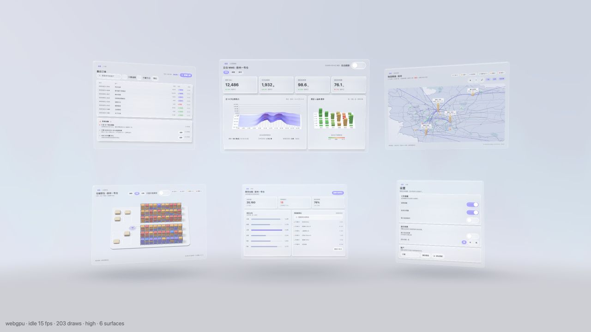
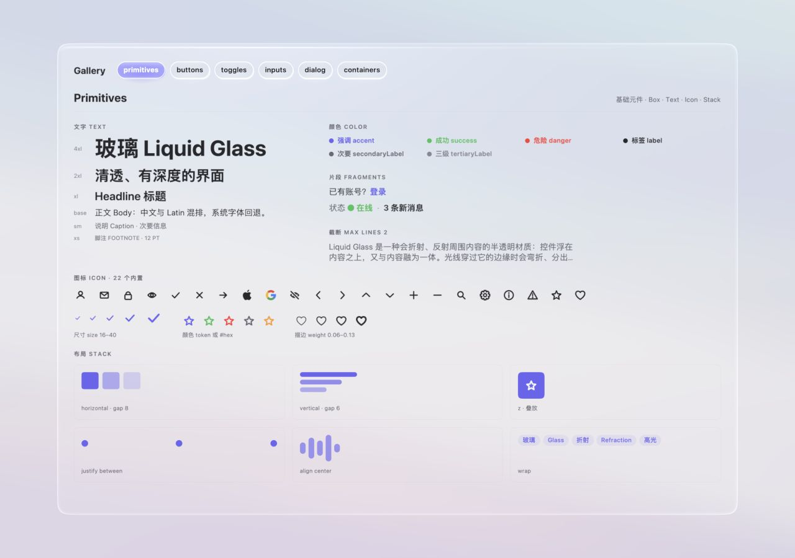
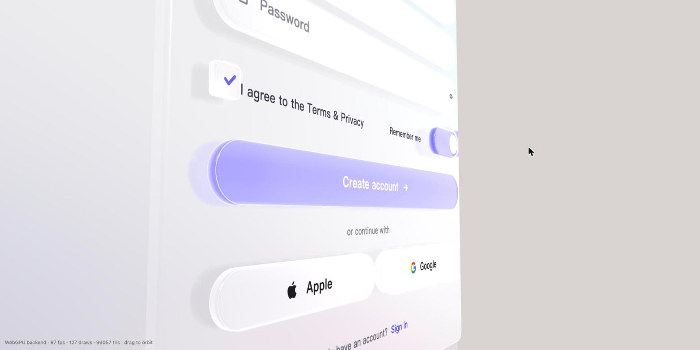

# ThreeDUI / GlassUI

**Build useful interfaces in three-dimensional space with Vue.** GlassUI is an experimental open-source component library for three.js: familiar Vue components become interactive surfaces in a real 3D scene. Ordinary controls, charts, maps, and application-specific 3D content can share one scene and camera.

[简体中文](./README.zh-CN.md) · [Get started](./docs/getting-started.md) · [Components](./docs/components.md) · [Spatial UI](./docs/spatial-ui.md) · [Agent skill](./.agents/skills/build-glassui/SKILL.md)



The spatial operations demo combines six views—orders, dashboard, network, warehouse twin, inventory, and settings. Its charts, map, and warehouse content share the scene and camera with the UI. It uses local sample data, not a live backend.

## Explore the demos

Requires Node.js 22.12+ and pnpm 11. From a clone of this repository:

```bash
pnpm install
pnpm playground
```

Open **[the demo index](http://127.0.0.1:5176/demos.html)**. It links to:

| Demo | What to look for | Direct URL |
| --- | --- | --- |
| Spatial application | Login, six connected views, camera focus, 3D charts/map/twin, contextual panels | [Open](http://127.0.0.1:5176/?scene=spatial) |
| Component gallery | Interactive primitives, buttons, toggles, inputs, dialogs, and glass containers | [Open](http://127.0.0.1:5176/?scene=gallery) |
| Sign-up form | Glass geometry, depth, input/IME, and lighting; left pan, right rotate, wheel zoom | [Open](http://127.0.0.1:5176/?scene=signup) |



For a quick view of all six application blocks, use [the spatial overview](http://127.0.0.1:5176/?scene=spatial&stage=overview). Add `&focus=inventory` (or `orders`, `dashboard`, `network`, `twin`, `settings`) to jump into a view. Gallery sections use `?scene=gallery&focus=buttons` and the other names shown in the gallery. [The demo guide](./docs/demos.md) lists every entry point and option.



## Use the library

The repository currently provides **workspace packages, not published npm releases**. Clone it and develop against the packages in this pnpm workspace. Start with [the runnable setup](./docs/getting-started.md), then use [the component guide](./docs/components.md) and generated [component manifest](./packages/vue/manifest.json) for exact props, events, slots, and examples. The [agent skill](./.agents/skills/build-glassui/SKILL.md) gives coding agents a short, source-backed workflow for building GlassUI apps.

Agents working in this repository can discover the skill through [`AGENTS.md`](./AGENTS.md). For an agent that does not load repository skills, point it directly at the skill file.

```vue
<script setup lang="ts">
import { ref } from 'vue'
import { Space, Block, Card, Text, Button, BarChart3D } from '@glassui/vue'
const focus = ref<string | null>(null)
const visits = [{ label: 'Mon', value: 120 }, { label: 'Tue', value: 160 }]
</script>

<template>
  <Space v-model:focus="focus" overview>
    <Block name="home" :width="560" :height="420">
      <Text value="Workspace" size="2xl" />
      <Button label="Analytics" @press="focus = 'analytics'" />
    </Block>
    <Block name="analytics" :width="720" :height="560">
      <Card title="Visits"><BarChart3D :data="visits" /></Card>
    </Block>
  </Space>
</template>
```

`Space` lays out and focuses `Block`s in world space; each `Block` owns a 3D surface. A `Surface` can also be placed directly in the world or on a camera-facing screen layer. The host owns the three.js renderer, camera, canvas, and frame loop. [See the complete setup](./docs/getting-started.md).

## What is implemented

- Vue 3 custom renderer, layout, themes, utilities, input and IME bridge.
- Screen and world surfaces, `Space`/`Block` composition, focus and camera motion.
- Glass controls: `Button`, `Input`, `Switch`, `Checkbox`, `Dialog`, `GlassContainer`, plus layout and text primitives.
- Scene-native visuals: `Viewport3D`, `BarChart3D`, `SurfaceChart3D`, `BarMatrix3D`, and `LineChart`.
- WebGPU rendering with WebGL2 fallback and selectable quality tiers.

This is an early-stage project. Package exports point to TypeScript source for workspace development. Browser/GPU support and performance vary by device. The [core design](./docs/superpowers/specs/2026-10-07-glassui-core-design.md) explains the rendering model and the [spatial design](./docs/superpowers/specs/2026-10-15-glassui-spatial-ui-design.md) explains the application direction.

## Repository

| Path | Purpose |
| --- | --- |
| [`packages/core`](./packages/core) | UI tree, layout, styles, events, focus |
| [`packages/text`](./packages/text) | Text and glyph infrastructure |
| [`packages/render`](./packages/render) | three.js renderer, materials, surfaces, camera rig |
| [`packages/vue`](./packages/vue) | Vue renderer and components; [machine-readable manifest](./packages/vue/manifest.json) |
| [`examples/playground`](./examples/playground) | Comprehensive app, gallery, and focused demos |
| [`examples/visual`](./examples/visual) | Playwright screenshot regression harness |
| [`docs`](./docs) | User guides and design history |

```bash
pnpm typecheck
pnpm test
pnpm playground:build
```

See [Contributing](./CONTRIBUTING.md) for development and test guidance. Visual baselines are machine-specific; follow [the visual-test guide](./examples/visual/README.md) before updating them.

## License

Apache-2.0. See [LICENSE](./LICENSE).
